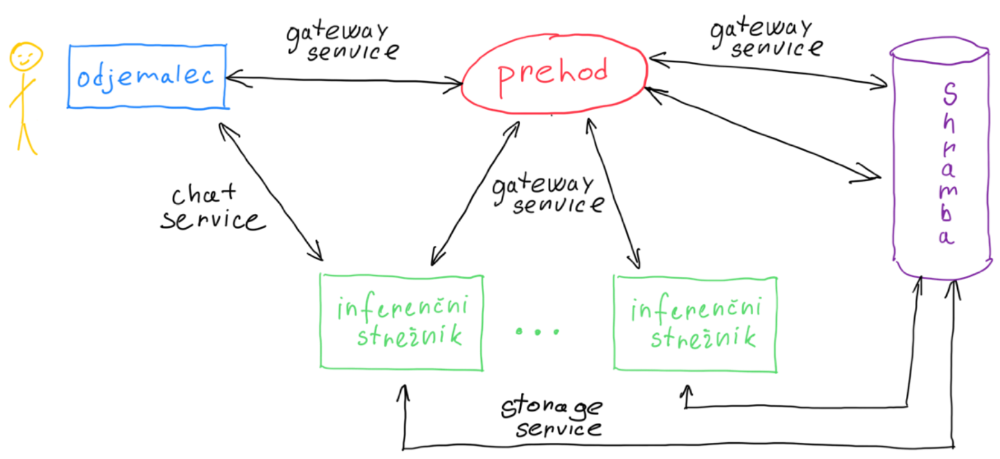

<p>

</p> 
<br>
<br>
<br>
<br>
<br>
<br>
<br>
<br>


# Projektna naloga


Ustvarite distribuirano spletno storitev **Klepec** po vzoru že kar nekaj časa mrtvega spletnega sogovornika [Petra Klepca](https://web.archive.org/web/20080831101935/http://klepec.amebis.si/), ki uporabnikom omogoča pogovor z velikim jezikovnim modelom, podobno kot storitve ChatGPT, Claude ali Gemini, le v manjšem obsegu.


Za klepet s Petrom se lahko prijavijo **uporabniki**, ki z njim vodijo **pogovor**. V pogovoru uporabnik pošilja **sporočila**, model pa na vsako sporočilo odgovori. Vsak uporabnik ima en sam pogovor. Klepec hrani zgodovino pogovora, zato lahko uporabnik kadarkoli zapusti storitev, se vanjo vrne in pogovor nadaljuje. Uporabnik lahko svoj pogovor tudi izbriše in začne novega.

Storitev napišite v programskem jeziku Go. Za izvajanje jezikovnega modela uporabite knjižnico [llama-go](https://github.com/liminalpurple/llama-go), ki je ovojnica okrog knjižnice [llama.cpp](https://github.com/ggml-org/llama.cpp). Za komunikacijo med strežniškimi vozlišči in z odjemalci (uporabniki) uporabite ogrodje **gRPC**. Prav tako napišite odjemalca, ki bo znal komunicirati s strežnikom in bo podpiral vse operacije, ki jih ponuja Klepec.

## Jezikovni model in knjižnica llama-go

Knjižnica llama-go omogoča, da jezikovni model poganjamo neposredno v programu Go, brez zunanjih storitev ali programskih vmesnikov v oblaku. Llama-go prek vmesnika CGO kliče funkcije knjižnice llama.cpp, ki modele v formatu GGUF izvaja lokalno na procesorju ali grafičnem pospeševalniku. Pri delu z njo ločimo dva pojma: **model** (`llama.Model`) hrani uteži modela in ga naložimo enkrat, **kontekst** (`llama.Context`) pa je delovno stanje, v katerem model obdeluje poziv in generira odgovor nanj. Za klepet llama-go ponuja klica `Chat`, ki vrne celoten odgovor naenkrat, in `ChatStream`, ki odgovor vrača sproti, žeton za žetonom.

Pri vsakem odgovoru model najprej prebere celoten pogovor do tistega trenutka in pri tem v pomnilniku zgradi predpomnilnik KV (*angl. KV cache*), ki je vezan na kontekst. Če naslednje sporočilo nadaljuje trenutni pogovor, llama.cpp ponovno uporabi del predpomnilnika, zgrajenega na podlagi dosedanjih sporočil (*angl. prefix caching*), zato se odgovor začne bistveno hitreje. To je tudi razlog, da produkcijske storitve poskušajo uporabnika vedno znova usmeriti na isti strežnik.

- Uporabite manjši model v formatu GGUF, ki teče na procesorju, na primer **Qwen3-0.6B** ali **Qwen3-1.7B**. Modele najdete na spletni strani [Hugging Face](https://huggingface.co/). Model Qwen3-1.7B je na voljo na [tej povezavi](https://huggingface.co/Qwen/Qwen3-1.7B-GGUF/tree/main).  
- Knjižnica `llama-go` uporablja CGO in jo je treba pred uporabo prevesti. Sledite navodilom v [repozitoriju](https://github.com/liminalpurple/llama-go). Če pri prevajanju programa dobite napake zaradi manjkajoče knjižnice OpenSSL, knjižnico prevedite z ukazom `CMAKE_ARGS="-DLLAMA_OPENSSL=OFF" make libbinding.a`.
- Model naložite enkrat v vsakem procesu (`llama.LoadModel`, z `llama.WithGPULayers(0)` za izvajanje na procesorju), nato pa ustvarite enega ali več kontekstov (`model.NewContext`), ki strežejo odjemalcem. Kontekst ni varen za sočasno uporabo: v vsakem trenutku ga lahko uporablja le en odjemalec.
- Pri vsakem klicu `ctx.Chat` modelu podate celotno zgodovino pogovora, če želite, da se pogovor smiselno nadaljuje. Kontekst si namreč zapomni le žetone zadnjega poziva.
- Poziv (sistemski poziv, zgodovina in novo sporočilo) skupaj s prostorom za odgovor (`MaxTokens`) mora biti krajši od velikosti konteksta. To preverite pred vsakim klicem `ctx.Chat`: če bi poziv mejo presegel, pred klicem odstranite najstarejše pozive in odgovore, sistemski poziv pa ohranite. Odstranjujte jih v večjih korakih, sicer se začetek poziva spremeni ob vsakem sporočilu in predpomnilnika ne morete ponovno uporabiti.

Primer minimalnega klepeta z llama-go najdete v datoteki [chat.go](./koda/chat.go).

## Podrobnosti naloge

Projektno nalogo rešujete v parih. Na spletni učilnici najdete [anketo](https://ucilnica.fri.uni-lj.si/mod/choicegroup/view.php?id=60665), prek katere se razdelite v pare.
Svojo rešitev v obliki modula objavite v javnem repozitoriju GitHub/GitLab in prek spletne učilnice [oddajte](https://ucilnica.fri.uni-lj.si/mod/assign/view.php?id=16663) povezavo do njega. Vaš repozitorij naj bo do izteka roka za oddajo zaseben, potem pa ga naredite javnega. **Rok za oddajo projektne naloge je 20. 1. 2027**. Po izteku roka bomo organizirali zagovore, na katerih boste predstavili svoje rešitve.

### Arhitektura storitve in programski vmesnik

Storitev sestavljajo tri vrste vozlišč:

- **Prehod** je vstopna točka za odjemalce in hkrati nadzorna ravnina storitve. S pomočjo doslednega zgoščevanja (*angl. consistent hashing*) odjemalcu pove, kateri inferenčni strežnik je odgovoren zanj. Inferenčni strežniki in shramba se ob zagonu prijavijo na prehod, inferenčni strežniki pa mu nato periodično pošiljajo srčne utripe. Prehod vodi seznam inferenčnih strežnikov in ob odpovedi strežnika seznam ustrezno popravi.
- **Inferenčni strežniki** izvajajo model in odgovarjajo na sporočila. Odjemalec se po dogovoru s prehodom poveže neposredno na enega od inferenčnih strežnikov.
- **Shramba** je strežnik, ki v delovnem pomnilniku hrani uporabnike in njihove pogovore. Z njo komunicirajo inferenčni strežniki (in prehod pri ustvarjanju uporabnika). Ob zagonu se prijavi na prehod, srčnih utripov pa ne pošilja, saj je zanesljiva. Naslov shrambe prehod posreduje inferenčnim strežnikom v sporočilu o stanju gruče.

Naslov prehoda inferenčnim strežnikom in shrambi podate kot argument ukazne vrstice, vse ostale naslove izvejo od prehoda. Dokler se ne registrirata vsaj en inferenčni strežnik in shramba, storitev ni dosegljiva.



Podano imate spodnjo specifikacijo v jeziku Protocol Buffer:

- `Gateway` implementira prehod; kličejo ga odjemalci (`CreateUser`, `GetServingNode`), inferenčni strežniki (`Register`, `Heartbeat`) in shramba (`Register`),
- `ChatService` implementirajo inferenčni strežniki; kličejo ga odjemalci,
- `Storage` implementira shramba; kličejo ga inferenčni strežniki in prehod.

```protobuf
syntax = "proto3";

package klepec;

option go_package = "/klepec";

import "google/protobuf/empty.proto";
import "google/protobuf/timestamp.proto";

////////////////////////////////////////////////////////////////////////////////
// Basic data types
////////////////////////////////////////////////////////////////////////////////
message User {
  int64 id = 1;
  string name = 2;
}

// One turn: the user's message and the model's answer
message Turn {
  int64 seq = 1;             //turn sequence number increases on per user basis; does not restart after ResetConversation
  string user_text = 2;
  string assistant_text = 3;
  google.protobuf.Timestamp created_at = 4;
}

enum NodeType {
  NODE_TYPE_UNSPECIFIED = 0;
  NODE_TYPE_INFERENCE   = 1;
  NODE_TYPE_STORAGE     = 2;
}

message NodeInfo {
  string node_id = 1;
  string address = 2;
  NodeType type = 3;
}

////////////////////////////////////////////////////////////////////////////////
// Gateway: entry point for clients and control plane for inference nodes
////////////////////////////////////////////////////////////////////////////////

service Gateway {
  // Client calls

  // Creates a new user and assigns it an id (stored in the storage)
  rpc CreateUser(CreateUserRequest) returns (User);

  // Returns the inference node responsible for the user
  rpc GetServingNode(ServingNodeRequest) returns (ServingNodeResponse);

  // Inference node and storage calls (control plane)

  // Called by an inference node or the storage when it starts. The gateway
  // adds an inference node to the active list and remembers the storage address.
  rpc Register(RegisterRequest) returns (ClusterState);

  // Called periodically by every inference node. A node whose heartbeats stop
  // is considered failed and is removed from the list.
  rpc Heartbeat(HeartbeatRequest) returns (ClusterState);
}

message CreateUserRequest {
  string name = 1;
  string request_id = 2; // generated by the client, reused on retry
}

message ServingNodeRequest {
  int64 user_id = 1;
}

message ServingNodeResponse {
  NodeInfo node = 1;
}

message RegisterRequest {
  NodeInfo node = 1;
}

message HeartbeatRequest {
  string node_id = 1;
}

message ClusterState {
  NodeInfo storage = 1;                  // the storage node
  repeated NodeInfo inference_nodes = 2; // live inference nodes
}

////////////////////////////////////////////////////////////////////////////////
// Chat API: client <-> inference node
////////////////////////////////////////////////////////////////////////////////
service ChatService {
  // Kept open by the client while it is connected. The open stream marks the
  // client as connected. 
  rpc Connect(ConnectRequest) returns (stream ConversationEvent);

  // Returns all turns of the user's conversation
  rpc GetHistory(GetHistoryRequest) returns (GetHistoryResponse);

  // Sends a message to the model and returns the answer.
  // The user message and the answer are stored before the call returns.
  rpc SendMessage(SendMessageRequest) returns (SendMessageResponse);

  // Deletes the conversation; the user starts a new, empty one
  rpc ResetConversation(ResetConversationRequest) returns (google.protobuf.Empty);
}

message ConnectRequest {
  int64 user_id = 1;
}

// Sent on the Connect stream
message ConversationEvent {
  oneof event {
    google.protobuf.Empty connected = 1;  // connection accepted
    Turn turn_appended = 2;               
    google.protobuf.Empty reset = 3;      // conversation was reset
  }
}


message GetHistoryRequest {
  int64 user_id = 1;
}

message GetHistoryResponse {
  repeated Turn turns = 1;
}

message SendMessageRequest {
  int64 user_id = 1;
  string text = 2;
  string request_id = 3; // generated by the client, reused on retry
}

message SendMessageResponse {
  Turn turn = 1;
  TokenUsage usage = 2;
}

message ResetConversationRequest {
  int64 user_id = 1;
  string request_id = 2; // generated by the client, reused on retry
}

message TokenUsage {
  int32 prompt_tokens = 1;    // tokens in the whole prompt given to the model
  int32 answer_tokens = 2;    // tokens in the model's answer
  int64 total_tokens = 3;     // all tokens used by the user so far
}

////////////////////////////////////////////////////////////////////////////////
// Storage API: inference node (and gateway) <-> storage
////////////////////////////////////////////////////////////////////////////////

service Storage {
  // Stores a new user and assigns it an id
  rpc CreateUser(CreateUserRequest) returns (User);

  // Appends one turn (user message + answer) to the user's conversation and
  // adds its tokens to the user's total, as one write. If a turn with the same
  // request_id is already stored, the stored turn and usage are returned and
  // nothing is appended or counted.
  rpc AppendTurn(AppendTurnRequest) returns (AppendTurnResponse);

  // Deletes all turns of the user's conversation
  rpc ResetConversation(ResetConversationRequest) returns (google.protobuf.Empty);

  // Returns all turns of the user's conversation
  rpc GetHistory(GetHistoryRequest) returns (GetHistoryResponse);
}

message AppendTurnRequest {
  int64 user_id = 1;
  string request_id = 2;
  string user_text = 3;
  string assistant_text = 4;
  int32 prompt_tokens = 5;
  int32 answer_tokens = 6;
}

message AppendTurnResponse {
  Turn turn = 1;
  TokenUsage usage = 2; // usage of this turn and the user's new total
  bool duplicate = 3;   // true if the turn was already stored
}
```
Odjemalec najprej pri prehodu z `GetServingNode` izve naslov svojega inferenčnega strežnika, nato pa vse klice `ChatService` pošilja neposredno temu strežniku. Če inferenčni strežnik odgovori z napako, odjemalec ponovno vpraša prehod za podatke o strežniku. 

Odjemalec pred začetkom pogovora pri svojem inferenčnem strežniku odpre tok s klicem `Connect` in ga drži odprtega, dokler odjemalec teče. Ko se odjemalec zapre ali odpove, se tok prekine in strežnik to zazna. Po toku strežnik odjemalcu pošilja obvestila o dogodkih povezanih s pogovorom.

Če odjemalec klic `SendMessage` prekliče, mu poteče rok ali pade povezava, strežnik generiranje ustavi ter sporočila in odgovora ne shrani. Če povezava pade šele po tem, ko sta sporočilo in odgovor shranjena, ostaneta v shrambi; odjemalec ju dobi, ko zahtevo ponovi z istim `request_id` ali z `GetHistory`.

Če uporabnik pogovor izbriše (`ResetConversation`) med generiranjem odgovora, se ta odgovor ne shrani v novi pogovor. Zaporedne številke sporočil (`seq`) se po brisanju ne začnejo znova, temveč se nadaljujejo.

Prehod v odgovorih na `Register` in `Heartbeat` inferenčnim strežnikom pošilja trenutno stanje gruče (`ClusterState`): naslov shrambe in seznam živih inferenčnih strežnikov. Tako inferenčni strežniki vedo, kje je shramba, in lahko preverijo, ali so odgovorni za uporabnika. Če inferenčni strežnik, ki je odpovedal, ponovno zaženete, se pri prehodu prijavi kot nov strežnik z novim `node_id`.

Vsi klici, ki zapisujejo v shrambo, nosijo `request_id`, ki ga ustvari odjemalec in ga pri ponovitvi zahteve ohrani. Shramba si zapomni že obdelane zahteve in ponovljenega zapisa ne izvede še enkrat, temveč vrne že shranjen rezultat. Tako lahko odjemalec zahtevo varno ponovi, tudi če je inferenčni strežnik odpovedal po tem, ko je sporočilo in odgovor že shranil, a preden je odgovoril.

Klic `SendMessage` vrne, koliko žetonov sta porabila poziv in odgovor modela (`TokenUsage`), ter skupno število žetonov, ki jih je uporabnik porabil od ustvarjanja računa. S tem merimo, koliko posamezen uporabnik uporablja model. Tako kot komercialni ponudniki štejemo celoten poziv, ki ga dobi model: sistemski poziv, zgodovino in novo sporočilo. Žetone preštejete s `model.FormatChatPrompt` in `ctx.Tokenize`. Brisanje pogovora skupnega števila porabljenih žetonov ne ponastavi.

### Kode napak

Klici oddaljenih funkcij naj vračajo standardne kode napak gRPC. V Go so konstante v paketu [`google.golang.org/grpc/codes`](https://pkg.go.dev/google.golang.org/grpc/codes), napake pa ustvarjate in berete s paketom [`google.golang.org/grpc/status`](https://pkg.go.dev/google.golang.org/grpc/status):

```go
// strežnik: obdelovalec vrne napako s kodo
return nil, status.Error(codes.NotFound, "user not found")

// odjemalec: preberemo kodo napake
if status.Code(err) == codes.FailedPrecondition { ... }
```

Predpisana uporaba kod napak v storitvi Klepec:

| Koda gRPC | Konstanta v Go | Pomen |
|---|---|---|
| `NOT_FOUND` | `codes.NotFound` | uporabnik ne obstaja; pri `Heartbeat`: prehod je vozlišče že odstranil |
| `FAILED_PRECONDITION` | `codes.FailedPrecondition` | inferenčni strežnik ni odgovoren za uporabnika: odjemalec vpraša prehod |
| `UNAVAILABLE` | `codes.Unavailable` | storitev ali vozlišče ni dosegljivo ali se je povezava prekinila |
| `DEADLINE_EXCEEDED` | `codes.DeadlineExceeded` | vozlišče ni odgovorilo v roku  |
| `ALREADY_EXISTS` | `codes.AlreadyExists` | uporabnik je že povezan z drugim odjemalcem: odjemalec o tem obvesti uporabnika |
| `RESOURCE_EXHAUSTED` | `codes.ResourceExhausted` | vrsta zahtev na inferenčnem strežniku je polna: odjemalec poskusi pozneje |


## Kriteriji ocenjevanja

Vaša naloga je, da implementirate zgornji programski vmesnik storitve in pripravite odjemalca, ki bo s storitvijo znal komunicirati in uporabljati vse oddaljene operacije, ki jih storitev ponuja. Vse podatki naj se hranijo v delovnem pomnilniku (*angl. in-memory storage*). Pripravite tudi demonstracijo delovanja strežnika in odjemalca, s katero boste nazorno prikazali, kaj vse vaša rešitev zmore.

 - **Ocena 6–7:** Strežnik je en sam in omogoča hkratno delo z več odjemalci. 
   - Prehod in shramba sta lahko del istega procesa: strežnik implementira `ChatService` ter klic `CreateUser`.
   - Vmesnik `Storage` lahko implementirate kot navadne klice funkcij. 
   - Strežnik naj ima na voljo omejene kapacitete za strežbo pogovorov. Če na strežniku ni več prostih kapacitet, strežnik nove zahteve zavrne. 
   - Strežnik si zapomni, kateri kontekst je nazadnje obdelal pogovor posameznega uporabnika, in ga za ta pogovor uporabi ponovno. Kadar so vsi konteksti zasedeni z drugimi pogovori, prepiše najdlje neuporabljenega (strategija LRU). Zgodovina je omejena na velikost konteksta.

 - **Ocena 7–8:** Storitev razdelite na prehod, inferenčne strežnike in shrambo, ki tečejo kot ločeni procesi. 
   - Predpostavite, da so vsa vozlišča popolnoma zanesljiva. 
   - Prehod uporabnike razporeja med inferenčne strežnike (vsaj dva) z zgoščevanjem `user_id`. Razporeditev mora imeti naslednje lastnosti: 
     - uporabnik je vedno usmerjen na isti strežnik, zato se lahko obstoječi kontekst ponovno uporabi; 
     - uporabniki so med strežnike razporejeni približno enakomerno; 
     - ob odpovedi strežnika se preselijo le njegovi uporabniki, ob prijavi novega pa sorazmeren delež uporabnikov.

      Primera takih razporejanj sta [dosledno zgoščevanje](https://dl.acm.org/doi/10.1145/258533.258660) (*angl. consistent hashing*) z navideznimi vozlišči in [zgoščevanje rendezvous](https://en.wikipedia.org/wiki/Rendezvous_hashing) (*angl. rendezvous hashing*). 
    - Uporabnik je lahko hkrati povezan le z enim odjemalcem: če se z istim `user_id` poveže še drug odjemalec, ga inferenčni strežnik zavrne z napako. Ko se prvi odjemalec odjavi ali odpove, se lahko poveže drug. 

 - **Ocena 9–10:** Kot pri oceni 7–8, le da inferenčni strežniki niso zanesljivi in lahko odpovejo. Prehod in shramba ostaneta zanesljiva.
    - Ob odpovedi inferenčnega strežnika prehod prerazporedi uporabnike na ostale strežnike.
    - Med delovanjem storitve naj bo možno dodati nov inferenčni strežnik, nanj naj se preseli sorazmeren delež uporabnikov, ostali ostanejo na svojih strežnikih.
    - Inferenčni strežnik streže le uporabnikom, za katere je odgovoren; ostale zavrne z napako. Odgovornost določi iz seznama aktivnih strežnikov na enak način kot prehod.
    - Omogočite, da je uporabnik lahko hkrati povezan z več odjemalci (na primer na prenosniku in telefonu), ki se s storitvijo pogovarjajo sočasno. Poskrbite za ustrezno usklajevanje pogovorov. 

**Najboljše tri rešitve** po izboru ocenjevalcev bodo dodatno nagrajene z bonusom na pisnem izpitu, in sicer:
  1. mesto: +30 %
  2. mesto: +20 %
  3. mesto: +10 %
   
Rešitve bodo rangirane tako na podlagi funkcionalnosti kot tudi samega zagovora.

 - **Nekaj predlogov izboljšav:**
    - Uporabite pakete za pisanje vmesnikov ukazne vrstice, kot so [cli](https://cli.urfave.org/), [cobra](https://pkg.go.dev/github.com/spf13/cobra), [kong](https://github.com/alecthomas/kong).
    - Uporabite pakete za pisanje grafičnih vmesnikov za strežnik in odjemalca, npr. [tview](https://github.com/rivo/tview).
    - Go ima vgrajeno [podporo](https://pkg.go.dev/testing) za pisanje testov. Pripravite nabor testov, ki validirajo delovanje vašega Klepca, vključno s testi odpovedi strežnikov (z lažnim modelom).
    - Dosledno zgoščevanje z omejeno obremenitvijo ([consistent hashing with bounded loads](https://arxiv.org/abs/1608.01350)): če je strežnik preobremenjen, prehod uporabnika usmeri na drug strežnik v seznamu. Podatke o obremenitvi (npr. dolžino vrste in število zasedenih kontekstov) dodajte v `HeartbeatRequest` sami.
    - Pretakanje odgovora (*angl. streaming*): `ChatService` dopolnite s klicem, ki odgovor odjemalcu pošilja sproti, žeton za žetonom (`ctx.ChatStream`). Specifikacijo razširite sami.
    - Storitev postavite na računskih vozliščih gruče Arnes in do nje dostopajte prek tunela SSH.
