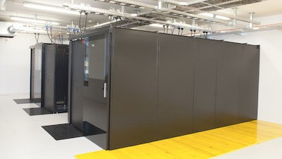

# Uporaba računske gruče Arnes

Pri predmetu Porazdeljeni sistemi bomo za delo lahko uporabljali računsko gručo [Arnes](https://www.sling.si/arnesova-racunska-gruca/). Trenutno je to drugi najzmogljivejši superračunalnik v Sloveniji ([prvi je Vega](https://si-vegadocs.vega.izum.si/specifikacije/)).

|  |
|:--:|
| *Računska gruča Arnes* |

## Specifikacije

- Strojna oprema: 108 vozlišč, 7736 procesorskih jeder, 74 grafičnih procesnih enot in ~60TB RAM

  | Vozlišča | Količina | Opis |
  |---|---|---|
  | wn[012-016] | 5 | [AMD EPYC 7232P](https://www.amd.com/en/products/processors/server/epyc/7002-series.html) (8c, 3.1GHz, 120W), 336GB RAM |
  | wn[021-061] | 41 | [AMD EPYC 9745](https://www.amd.com/en/products/processors/server/epyc/9005-series/amd-epyc-9745.html) (128c, 2.4GHz, 400W), 1TB RAM |
  | wn[101-110] | 10 | [AMD EPYC 7702P](https://www.amd.com/en/products/processors/server/epyc/7002-series.html) (64c, 2.0GHz, 200W), 512GB RAM |
  | wn[111-121] | 11 | [AMD EPYC 7702P](https://www.amd.com/en/products/processors/server/epyc/7002-series.html) (64c, 2.0GHz, 200W), 256GB RAM |
  | wn[163-169] | 7 | [AMD EPYC 9534](https://www.amd.com/en/products/processors/server/epyc/4th-generation-9004-and-8004-series/amd-epyc-9534.html) (64c, 2.45GHz, 280W), 512GB RAM |
  | wn[201-224] | 24 | 2x [Nvidia V100S](https://www.nvidia.com/en-us/data-center/v100/), [AMD EPYC 7272](https://www.amd.com/en/products/processors/server/epyc/7002-series.html) (12c, 2.9GHz, 120W), 128GB RAM |
  | gwn[01-07] | 7 | 2x [Nvidia H100 PCIe](https://www.nvidia.com/en-us/data-center/h100/), 2x [AMD EPYC 9124](https://www.amd.com/en/products/processors/server/epyc/4th-generation-9004-and-8004-series/amd-epyc-9124.html) (16c, 3.0GHz, 200W), 256GB RAM |
  | gwn[08-10] | 3 | 4x [Nvidia H100 SXM5](https://www.nvidia.com/en-us/data-center/h100/), 2x [AMD EPYC 9254](https://www.amd.com/en/products/processors/server/epyc/4th-generation-9004-and-8004-series/amd-epyc-9254.html) (24c, 2.9GHz, 200W), 512GB RAM |

- Programska oprema
  - OS [AlmaLinux 9](https://almalinux.org/)
  - Porazdeljen datotečni sistem [Ceph](https://ceph.io/en/)
  - Sistem za upravljanje s posli [SLURM](https://slurm.schedmd.com/)

Do sistema bomo dostopali preko povezave SSH. Uporabniške račune in gesla za dostop najdete na [spletni učilnici FRI](https://ucilnica.fri.uni-lj.si/mod/assign/view.php?id=37145). Dostop je mogoč samo z uporabo ustreznega ključa SSH in dvostopenjske avtentikacije (2FA). Kako si ustvarite lasten ključ in ga dodate v sistem za upravljanje z identitetami, je opisano v [navodilih za ključ SSH](https://doc.sling.si/workshops/supercomputing-essentials/02-slurm/06-ssh-key/). Za vzpostavitev dvostopenjske avtentikacije sledite [navodilom za 2FA](https://www.sling.si/dvostopenjska-avtentikacija-za-dostop-do-arnesove-racunske-gruce/). Ko ste uredili vse potrebno, se na gručo preko ukazne vrstice povežete z ukazom:

```bash
ssh <uporabnisko_ime>@hpc-login3.arnes.si
```

## Nastavitev okolja

Pri delu z gručo lahko uporabljate poljubno orodje za oddaljen dostop (ukazna lupina, MobaXterm, PuTTY, FileZilla, WinSCP, Cyberduck, Termius ...). Priporočamo pa uporabo orodja [VSCode](https://code.visualstudio.com/) v kombinaciji z razširitvijo [Remote - SSH](https://code.visualstudio.com/docs/remote/ssh). Kako vzpostavite povezavo, je opisano v [navodilih za VSCode](https://doc.sling.si/navodila/vscode/). Pri nastavitvi uporabite Arnesovo vstopno vozlišče `hpc-login3.arnes.si`!

Pri uporabi VSCode je delo z dvostopenjsko avtentikacijo nekoliko nerodno. Pri prijavi morate kodo vnesti dvakrat, pri čemer kodi ne smeta biti enaki. Priporočamo uporabo žetonov Kerberos (krb5), kot je opisano v [navodilih](https://www.sling.si/dvostopenjska-avtentikacija-za-dostop-do-arnesove-racunske-gruce/). V operacijskem sistemu Windows žetoni niso podprti, lahko pa jih generirate v okolju WSL in VSCode naročite, naj za povezovanje uporabi odjemalca SSH znotraj okolja WSL. V poljubni mapi ustvarite skriptno datoteko `ssh.bat` z vsebino:

```bat
wsl --exec ssh %*
```

Nato pa v okolju VSCode spremenite nastavitev `Remote.SSH: Path` (JSON: `remote.SSH.path`) tako, da vsebuje absolutno pot do vaše datoteke `ssh.bat`. Vaš privatni ključ in konfiguracijsko datoteko `config`, ki se običajno nahajata v mapi `C:\Users\<uporabnik>\.ssh\`, morate prenesti v mapo `~/.ssh` v okolju WSL. Popraviti morate tudi pravice za dostop vašega privatnega ključa:

```bash
chmod 600 ~/.ssh/<datoteka_s_privatnim_kljucem>
```

## Zaganjanje poslov na gruči

Vodič za delo na gruči in uporabo vmesne programske opreme [SLURM](https://slurm.schedmd.com/) za upravljanje s posli in nalogami najdete v tečaju [Osnove superračunalništva](https://doc.sling.si/workshops/supercomputing-essentials/01-intro/01-course/). Vsem udeležencem predmeta priporočamo, da tečaj predelajo. Pri delu z gručo bomo uporabljali rezervacijo `fri`, tako da nam ne bo treba dolgo čakati, da se naši posli izvedejo. V rezervaciji imamo na voljo eno računsko vozlišče (`wn101`), ki ga ostali uporabniki gruče ne morejo zasesti. Rezervacijo pri zaganjanju posla uporabite na naslednji način:

```bash
srun --reservation=fri <ime_programa>
```
Tako zagnan posel lahko prekinemo s pritiskom kombinacije `Ctrl-C`.

Posle lahko zaganjate tudi s pomočjo opisne skripte bash, v kateri navedete zahteve posla. Primer skripte:

```bash
#!/bin/bash
#SBATCH --job-name=my_job_name
#SBATCH --partition=all
#SBATCH --reservation=fri
#SBATCH --ntasks=4
#SBATCH --nodes=1
#SBATCH --mem-per-cpu=100MB
#SBATCH --output=my_job.out
#SBATCH --time=00:01:00

srun hostname
```

Zgornjo skripto shranite v datoteko s končnico `.sh`, npr. `posel.sh`, in jo zaženite z ukazom:

```bash
sbatch posel.sh
```

## Uporabni ukazi SLURM

| Ukaz | Pomen |
|---|---|
| `sinfo` | stanje particij in vozlišč |
| `squeue --me` | moji posli v čakalni vrsti |
| `scancel <id_posla>` | prekinitev posla |
| `scontrol show job <id_posla>` | podrobnosti posla |
| `scontrol show reservation fri` | podrobnosti rezervacije `fri` |

## Naloga

*Ne šteje kot ena izmed osmih nalog pri predmetu!*

1. Spremenite privzeto uporabniško geslo na [https://fido.sling.si/](https://fido.sling.si/).
2. Ustvarite in dodajte ključ SSH v uporabniški profil na [https://fido.sling.si/](https://fido.sling.si/). Pomagajte si z [navodili za ključ SSH](https://doc.sling.si/workshops/supercomputing-essentials/02-slurm/06-ssh-key/).
3. Vzpostavite dvostopenjsko avtentikacijo (2FA) in avtentikacijo s pomočjo žetonov krb5 po [navodilih](https://www.sling.si/dvostopenjska-avtentikacija-za-dostop-do-arnesove-racunske-gruce/).
4. Preko SSH se povežite na vstopno vozlišče Arnes: `hpc-login3.arnes.si`.
5. Zaženite program `hostname` na računskem vozlišču znotraj rezervacije `fri`.
6. Zaženite program `nvidia-smi` (izpiše informacije o grafičnih procesnih enotah na vozlišču). Pri zagonu morate uporabiti ustrezno particijo z računskimi vozlišči, ki vsebujejo GPE (`--partition=gpu`).
7. Kogar zanima več, lahko predela delavnico [Osnove superračunalništva](https://doc.sling.si/workshops/supercomputing-essentials/01-intro/01-course/).
