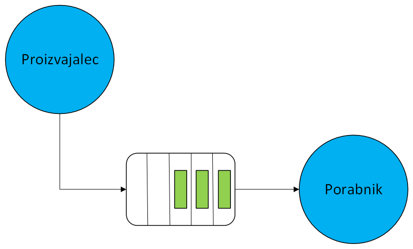

# Proizvajalci-porabniki

V porazdeljenih sistemih se pogosto pojavlja vzorec proizvajalec-porabnik, kjer sodelujeta dva tipa procesov:
- proizvajalci, ki generirajo zahteve, dogodke ali podatke;
- porabniki, ki te zahteve, dogodke ali podatke obdelujejo.

Ključno je, da komunikacija poteka preko skupnega medpomnilnika.
Ta pristop omogoča usklajevanja hitrosti med proizvajalci in porabniki: proizvajalec lahko dela hitreje ali počasneje kot porabnik, medpomnilnik pa služi kot vmesni prostor, ki zagotavlja, da podatki ne izginejo.

V programskem jeziku Go, lahko ta koncept realiziramo s pomočjo gorutin (proizvajalci in porabniki) in kanalov (skupni medpomnilnik).



Primeri iz tega poglavja so urejeni v en modul, pri čemer ima vsak program svoj direktorij. Najdete jih v mapi [koda](koda/):
```
koda/
├── go.mod                           
├── 01-brez-cakanja/
│   └── proizvajalec-porabnik-1.go    
├── 02-zaustavitev-brez-cakanja/
│   └── proizvajalec-porabnik-2.go
├── 03-zaustavitev-s-cakanjem/
│   └── proizvajalec-porabnik-3.go
└── 04-zaustavitev-s-kontekstom/
    └── proizvajalec-porabnik-4.go
```
Posamezen primer zaženemo iz mape `koda` z ukazom `go run <mapa primera>`.

## Primeri implementacij proizvajalcev in porabnikov

Vsi štirje primeri imajo enako zgradbo. Glavna gorutina zažene 10 proizvajalcev in 10 porabnikov, ki si delijo kanal `data` brez medpomnilnika. Proizvajalec v zanki poveča svoj števec in njegovo vrednost pošlje v kanal, porabnik pa ob vsakem prejetem podatku poveča svoj števec. Po dveh sekundah glavna gorutina s funkcijo `checkWork` izpiše stanje vseh števcev in vrednost `TOTAL`, ki je razlika med številom proizvedenih in porabljenih podatkov. Primeri se razlikujejo le po tem, kako proizvajalce in porabnike ustavimo.

### Primer 1: brez zaustavitve

Proizvajalci in porabniki tečejo v neskončnih zankah. Glavna gorutina dve sekundi počaka in izpiše števce, ne da bi gorutine ustavila. Program ima dve težavi:
- gorutine se nikoli ne ustavijo, ampak se prekinejo šele ob koncu programa;
- glavna gorutina bere števce, medtem ko jih gorutine še spreminjajo. 

[proizvajalec-porabnik-1.go](koda/01-brez-cakanja/proizvajalec-porabnik-1.go)

### Primer 2: zaustavitev brez čakanja

Glavna gorutina gorutinam sporoči, naj se ustavijo, tako da zapre kanal `quit`. Branje iz zaprtega kanala nikoli ne blokira, zato z enim klicem `close(quit)` hkrati obvestimo vse gorutine. 

```Go
	select {
	case <-quit:
		return
	default:
		p.counter++
		data <- p.counter
	}
```
Proizvajalec signal preveri pred vsakim pošiljanjem, porabnik pa s stavkom `select` hkrati čaka na podatek ali na signal. Težava ostaja, saj glavna gorutina ne počaka, da se gorutine zares ustavijo, preden izpiše števce. Poleg tega porabniki ob signalu končajo, proizvajalec, ki je ravno pošiljal podatek, pa obtiči pri pošiljanju za vedno, saj podatka nihče več ne prevzame.

[proizvajalec-porabnik-2.go](koda/02-zaustavitev-brez-cakanja/proizvajalec-porabnik-2.go)

### Primer 3: zaustavitev s čakanjem

Gorutine ustavimo v pravilnem vrstnem redu in na vsako skupino počakamo s čakalno skupino:
```Go
	close(quit)        // proizvajalcem sporočimo, naj končajo
	wgProducer.Wait()  // počakamo, da končajo
	close(data)        // porabnikom sporočimo, da podatkov ne bo več
	wgConsumer.Wait()  // počakamo, da porabijo vse podatke
```
Kanal naj zapre pošiljatelj, saj le on ve, kdaj podatkov ne bo več. Ker je pošiljateljev več, kanala `data` ne sme zapreti nobeden od njih, saj bi ostali ob pisanju v zaprt kanal povzročili paniko. Kanal zato zapre glavna gorutina, ko se vsi proizvajalci zaključijo. Porabniki ne poslušajo signala `quit`, ampak z zanko `for range data` berejo, dokler kanal ni zaprt in prazen. Tako prevzamejo tudi podatke, ki so jih proizvajalci pošiljali ob signalu.

[proizvajalec-porabnik-3.go](koda/03-zaustavitev-s-cakanjem/proizvajalec-porabnik-3.go)

### Primer 4: zaustavitev s kontekstom

Primer je enak primeru 3, le da namesto lastnega kanala `quit` uporabimo kontekst iz paketa `context`, ki je v jeziku Go standardni način za preklic dela v gorutinah. Metoda `ctx.Done()` vrne kanal, ki se zapre, ko je kontekst preklican, zato ga v stavku `select` uporabimo enako kot kanal `quit`:
```Go
	ctx, cancel := context.WithTimeout(context.Background(), 2*time.Second)
	defer cancel()
```
Kontekst s časovno omejitvijo se po dveh sekundah prekliče sam, zato glavna gorutina namesto klicev `time.Sleep` in `close(quit)` le počaka na `<-ctx.Done()`. S funkcijo `cancel` lahko kontekst prekličemo tudi sami, na primer ob nekem dogodku. Kontekst lahko podamo naprej vsem funkcijam, ki naj se ob preklicu ustavijo, zato se ga uporablja tudi v standardni knjižnici, na primer pri mrežnih zahtevah.

[proizvajalec-porabnik-4.go](koda/04-zaustavitev-s-kontekstom/proizvajalec-porabnik-4.go)


# Domača naloga 4

Napišite program v jeziku Go, ki bo omogočal procesiranje naročil, ki jih kupci oddajo preko spletne trgovine. Rešitev oddajte preko [spletne učilnice](https://ucilnica.fri.uni-lj.si/mod/assign/view.php?id=54457).

**Navodila:**

Uporabite vmesnik `narocilo` in strukture za različne vrste naročil iz prejšnje domače naloge:
```Go
type narocilo interface {
	obdelaj() error
}

type izdelek struct {
	imeIzdelka string
	cena       float64
	teza       float64
}

type eknjiga struct {
	naslovKnjige string
	cena         float64
}

type spletniTecaj struct {
	imeTecaja   string
	trajanjeUre int
	cenaUre     float64
}
```

Metoda `obdelaj` naj tako kot pri prejšnji domači nalogi najprej preveri, ali je naročilo veljavno, in v nasprotnem primeru vrne napako, ki pove, katero naročilo je neveljavno in zakaj. Veljavno naročilo naj izpiše na zaslon, njegovo vrednost prišteje globalni spremenljivki `promet`, v kateri beležimo skupno vrednost vseh obdelanih naročil, in poveča globalni števec obdelanih naročil `stNarocil`. Vrednost naročila je pri izdelku in e-knjigi enaka ceni, pri spletnem tečaju pa zmnožku `trajanjeUre * cenaUre`. Neveljavno naročilo naj vrednosti spremenljivk `promet` in `stNarocil` pusti nespremenjeni.

Primer izpisa metode `obdelaj()`:
```
Številka naročila: 1
Ime izdelka: Prenosni računalnik
Cena: 2000 €
Teža: 2.5 kg
```

Ustvarite **pet** gorutin (proizvajalcev), ki naključno generirajo naročila različnih tipov. Vsaka gorutina naj generira po dve naročili na sekundo. Proizvajalci naj občasno ustvarijo tudi neveljavno naročilo. Naročila naj pošiljajo v skupen kanal s kapaciteto 10.
Ustvarite **dve** gorutini (porabnika), ki naročila obdelujeta s pomočjo metode `obdelaj`. Obdelava naročila naj traja 0,5 sekunde. Če metoda `obdelaj` vrne napako, naj jo porabnik izpiše in nadaljuje z obdelavo naslednjega naročila.

V programu omogočite varno zaustavitev spletne trgovine. Ob pritisku na tipko `Enter` naj proizvajalci prenehajo ustvarjati nova naročila. Vsa naročila, ki so bila že oddana, naj se obdelajo, nato naj se izpišeta skupni promet in število obdelanih naročil.

Pri posodabljanju spremenljivk `promet` in `stNarocil` s ključavnicami poskrbite, da ne pride do hkratnega spreminjanja vrednosti s strani več gorutin. Prav tako poskrbite, da se izpisi različnih naročil med sabo ne premešajo.

**Rok za oddajo: 16. 11. 2026**

