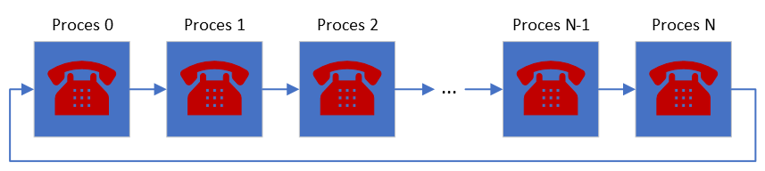

# Posredovanje sporočil

Pri komunikaciji med procesi v omrežju se običajno naslanjamo na komunikacijski sklad, ki ga nudi operacijski sistem. Običajno uporabljamo protokol Ethernet, ki deluje na povezavni plasti komunikacijskega sklada in ga nadgrajuje protokol IP (angl. Internet Protocol) na internetni plasti. Transportna plast nadgrajuje internetno in tu najdemo protokola, kot sta TCP (angl. Transmission Control Protocol) in UDP (angl. User Datagram Protocol). Po potrebi se nad transportno plastjo nahajajo še dodatne plasti, ki nudijo specifične funkcionalnosti za dano aplikacijo (šifriranje, avtentikacija, ...).

Protokol TCP je namenjen zanesljivemu prenosu podatkov med dvema procesoma. Skrbi za odpravljanje napak pri prenosu, razrešuje podvajanje in izgubo paketov ter nadzira pretok. Uporablja povezavni način komuniciranja, kjer procesa najprej vzpostavita povezavo in šele nato lahko začneta med sabo izmenjavati uporabne podatke. S protokolom TCP pridobimo na zanesljivosti prenosov na račun manjše prepustnosti. 

Če zanesljivost ni pomembna, ampak želimo čim večjo prepustnost in čim manjšo zakasnitev, se lahko poslužimo protokola UDP. Ta uporablja brezpovezavni način komunikacije in omogoča hiter prenos podatkov, vendar na račun zanesljivosti. Ne omogoča nadzora pretoka, prav tako ne zagotavlja dostave ali pravilnega vrstnega reda sporočil. Za razliko od protokola TCP tu nimamo opravka s podatkovnim tokom, ki ga protokol samodejno razbije na podatkovne pakete, ampak aplikacija sama pripravi pakete omejene dolžine (angl. datagram) in jih pošlje prejemniku.

## Primer aplikacije
Delovanje protokolov TCP in UDP bomo prikazali na simulirani igri »telefončki«. Glavni proces pošlje sporočilo naslednjemu v vrsti. Ta sporočilo prejme, ga dopolni/spremeni in posreduje naslednjemu. Zadnji proces v vrsti prejme sporočilo, ga dopolni in vrne glavnemu procesu. Ta ga na koncu izpiše, s tem se izmenjava sporočil zaključi.



Primera iz tega poglavja najdete v mapi [koda](koda/):
```
koda/
├── go.mod
├── run_telefon.sh
├── telefonTCP/
│   └── telefon.go
└── telefonUDP/
    └── telefon.go
```
Vsak proces zaženemo posebej, na primer v ločenih terminalih iz mape `koda`. Za tri procese, ki komunicirajo prek protokola TCP, uporabimo ukaze `go run ./telefonTCP -p 9000 -id 1 -n 3`, `go run ./telefonTCP -p 9000 -id 2 -n 3` in `go run ./telefonTCP -p 9000 -id 0 -n 3`. Na gruči Arnes vse procese hkrati zaženemo s skripto `sbatch run_telefon.sh`.

### Komunikacija preko protokola TCP

Vsak proces mora delovati kot odjemalec in strežnik hkrati. Določiti moramo vrata, na katerih bo poslušal za prihajajoče sporočilo, in vrata, na katera bo svoje sporočilo poslal. Da je primer enostaven, bomo vse procese zagnali na enem vozlišču. S tem se izognemo nastavljanju naslovov IP za vsak proces.

Vsak proces dobi svoj `id`, hkrati pa mora tudi vedeti, koliko procesov je bilo zagnanih. Komunikacija poteka po zaporednih vratih od izhodiščnih naprej. Izhodiščna vrata nastavimo preko argumenta ukazne vrstice, prav tako `id` procesa in skupno število vseh procesov. 
```Go
package main

import (
	"flag"
	"fmt"
	"net"
	"time"
)

type message struct {
	data   []byte
	length int
}

var N int
var id int

func checkError(err error) {
	if err != nil {
		panic(err)
	}
}
func receive(addr *net.TCPAddr) message {
	// Poslušamo
	listener, err := net.ListenTCP("tcp", addr)
	checkError(err)
	defer listener.Close()
	fmt.Println("Telefon", id, "posluša na", addr)
	conn, err := listener.Accept()
	checkError(err)
	defer conn.Close()
	buffer := make([]byte, 1024)
	// Preberemo sporočilo
	mLen, err := conn.Read(buffer)
	checkError(err)
	fmt.Println("Telefon", id, "prejel:", string(buffer[:mLen]))
	// Vrnemo sporočilo
	rMsg := message{}
	rMsg.data = append(rMsg.data, buffer[:mLen]...)
	rMsg.length = mLen
	return rMsg
}

func send(addr *net.TCPAddr, msg message) {
	var err error
	retry := 5
	var conn *net.TCPConn
	// Odpremo povezavo, lahko je potrebnih več poskusov, če še niso vsi pripravljeni
	for retry != 0 {
		conn, err = net.DialTCP("tcp", nil, addr)
		if err == nil {
			break
		}
		retry--
		time.Sleep(time.Second / 2)
	}
	checkError(err)
	defer conn.Close()
	fmt.Println("Telefon", id, "se je povezal na", addr)
	// Pripravimo sporočilo
	sMsg := fmt.Sprint(id) + "-"
	sMsg = string(msg.data[:msg.length]) + sMsg
	_, err = conn.Write([]byte(sMsg))
	checkError(err)
	fmt.Println("Telefon", id, "poslal sporočilo", sMsg, "telefonu na naslovu", addr)

}

func main() {
	// Preberi argumente
	portPtr := flag.Int("p", 9000, "# start port")
	idPtr := flag.Int("id", 0, "# process id")
	NPtr := flag.Int("n", 2, "total number of processes")
	flag.Parse()

	rootPort := *portPtr
	id = *idPtr
	N = *NPtr
	basePort := rootPort + id
	nextPort := rootPort + ((id + 1) % N)
	// Ustvari potrebne mrežne naslove
	localAddr, err := net.ResolveTCPAddr("tcp", fmt.Sprintf("localhost:%d", basePort))
	checkError(err)
	remoteAddr, err := net.ResolveTCPAddr("tcp", fmt.Sprintf("localhost:%d", nextPort))
	checkError(err)

	// Izmenjava sporočil
	if id == 0 {
		send(remoteAddr, message{})
		rMsg := receive(localAddr)
		fmt.Println(string(rMsg.data[:rMsg.length]) + "0")
	} else {
		rMsg := receive(localAddr)
		send(remoteAddr, rMsg)
	}

}
```

### Komunikacija preko protokola UDP

Za razliko od komunikacije preko TCP, tukaj posamezni proces ne more vedeti, kdaj je naslednji proces v vrsti začel poslušati na vratih. Če je sporočilo poslano, preden je prejemnik pripravljen, se bo izgubilo. Da zagotovimo pripravljenost vseh procesov, uvedemo gorutino `heartBeat`, ki poskrbi, da glavni proces `id==0` počaka na prejem obvestil od vseh ostalih procesov, da so pripravljeni, preden pošlje sporočilo prvemu. Vsak proces najprej odpre vrata, na katerih bo poslušal, in šele nato začne glavnemu procesu pošiljati utripe. Utrip tako pomeni, da je proces pripravljen na prejem sporočila. Proces neha pošiljati utripe, ko odda svoje sporočilo; to gorutini `heartBeat` sporoči z zaprtjem kanala `stopHeartbeat`. Ker UDP ne zagotavlja dostave, se sporočilo še vedno lahko izgubi, vendar se to na enem računalniku zgodi le redko.

```Go
package main

import (
	"flag"
	"fmt"
	"net"
	"time"
)

type message struct {
	data   []byte
	length int
}

var start chan struct{}
var stopHeartbeat chan struct{}
var N int
var id int

func checkError(err error) {
	if err != nil {
		panic(err)
	}
}
func receive(conn *net.UDPConn) message {
	buffer := make([]byte, 1024)
	// Preberemo sporočilo
	mLen, err := conn.Read(buffer)
	checkError(err)
	fmt.Println("Telefon", id, "prejel sporočilo:", string(buffer[:mLen]))
	// Vrnemo sporočilo
	rMsg := message{}
	rMsg.data = append(rMsg.data, buffer[:mLen]...)
	rMsg.length = mLen
	return rMsg
}

func send(addr *net.UDPAddr, msg message) {
	// Odpremo povezavo
	conn, err := net.DialUDP("udp", nil, addr)
	checkError(err)
	defer conn.Close()
	// Pripravimo sporočilo
	sMsg := fmt.Sprint(id) + "-"
	sMsg = string(msg.data[:msg.length]) + sMsg
	_, err = conn.Write([]byte(sMsg))
	checkError(err)
	fmt.Println("Telefon", id, "poslal sporočilo", sMsg, "telefonu na naslovu", addr)
	// Ustavimo heartbeat servis
	close(stopHeartbeat)
}

func heartBeat(addr *net.UDPAddr) {

	if id != 0 {
		// Ostali javljajo procesu 0, da so pripravljeni
		conn, err := net.DialUDP("udp", nil, addr)
		checkError(err)
		defer conn.Close()
		beat := [1]byte{byte(id)}
		for {
			select {
			case <-stopHeartbeat:
				// Kanal je zaprt, prenehamo pošiljati utripe
				return
			default:
				conn.Write(beat[:])
				time.Sleep(time.Second)
			}
		}
	} else {
		// Posluša samo 0
		conn, err := net.ListenUDP("udp", addr)
		checkError(err)
		defer conn.Close()
		beat := make([]byte, 1)
		clients := make(map[byte]bool)
		// Čakamo, da se javijo vsi ostali procesi
		for len(clients) < N-1 {
			_, err = conn.Read(beat)
			checkError(err)
			clients[beat[0]] = true
			fmt.Println("Telefon", id, "prejel utrip od", beat[0], "- javljenih:", len(clients))
		}
		// Vsi so se javili, glavni proces lahko začne
		close(start)
	}
}

func main() {
	// Preberi argumente
	portPtr := flag.Int("p", 9000, "# start port")
	idPtr := flag.Int("id", 0, "# process id")
	NPtr := flag.Int("n", 2, "total number of processes")
	flag.Parse()

	rootPort := *portPtr
	id = *idPtr
	N = *NPtr
	basePort := rootPort + 1 + id
	nextPort := rootPort + 1 + ((id + 1) % N)

	// Ustvari potrebne mrežne naslove
	rootAddr, err := net.ResolveUDPAddr("udp", fmt.Sprintf("localhost:%d", rootPort))
	checkError(err)

	localAddr, err := net.ResolveUDPAddr("udp", fmt.Sprintf("localhost:%d", basePort))
	checkError(err)

	remoteAddr, err := net.ResolveUDPAddr("udp", fmt.Sprintf("localhost:%d", nextPort))
	checkError(err)

	// Ustvari kanala: start signalizira, da so vsi procesi pripravljeni,
	// z zaprtjem stopHeartbeat pa ustavimo pošiljanje utripov
	start = make(chan struct{})
	stopHeartbeat = make(chan struct{})

	// Najprej začnemo poslušati
	conn, err := net.ListenUDP("udp", localAddr)
	checkError(err)
	defer conn.Close()
	fmt.Println("Telefon", id, "posluša na", localAddr)

	// Zaženemo heartbeat servis, ki čaka na javljanje vseh udeleženih procesov
	go heartBeat(rootAddr)

	// Izmenjava sporočil
	if id == 0 {
		<-start
		send(remoteAddr, message{})
		rMsg := receive(conn)
		fmt.Println(string(rMsg.data[:rMsg.length]) + "0")
	} else {
		rMsg := receive(conn)
		send(remoteAddr, rMsg)
	}
}
```
# Domača naloga 6

Vaša naloga je, da napišete program v Go za razširjanje sporočil med procesi. Rešitev oddajte preko [spletne učilnice](https://ucilnica.fri.uni-lj.si/mod/assign/view.php?id=60827). Program naj preko ukazne vrstice prejme naslednje argumente:
- identifikator procesa `id`: celo število, ki identificira posamezen proces znotraj skupine,
- število vseh procesov v skupini `N`,
- identifikator glavnega procesa `root`: celo število, ki identificira proces, ki bo sporočilo razširil med ostale,
- izhodiščna vrata `p`: proces z identifikatorjem `id` posluša na vratih `p + id`.

Procesi naj za komunikacijo uporabljajo protokol **UDP**. Sporočilo razširja samo glavni proces, ki ga neposredno pošlje vsem ostalim procesom. Ker UDP ne zagotavlja dostave, naj glavni proces vsakemu prejemniku sporočilo pošilja večkrat (največ petkrat), dokler od njega ne dobi potrditve. Med posamezna pošiljanja dodajte kratko pavzo (500 ms). Prejemnik zato isto sporočilo lahko prejme večkrat. Ob vsakem prejemu naj glavnemu procesu vrne potrditev (prejšnja potrditev se je morda izgubila), sporočilo pa naj na zaslon izpiše samo ob **prvem** prejemu. 

Pri poslušanju za sporočila je priporočeno, da nastavite rok za branje z metodo [SetReadDeadline](https://pkg.go.dev/net#Conn) ali pa kako drugače poskrbite, da se proces zaključi in sprosti vrata, če po nekem času ne dobi sporočila. S tem se boste izognili težavam z zasedenostjo vrat, če proces čaka na sporočilo, ki nikoli ne pride. V procesih ni treba uporabiti principa preverjanja utripa za ugotavljanje, ali so procesi prejemniki pripravljeni oziroma živi. Glavni proces naj kar takoj začne pošiljati sporočila. 


**Rok za oddajo: 30. 11. 2026**
